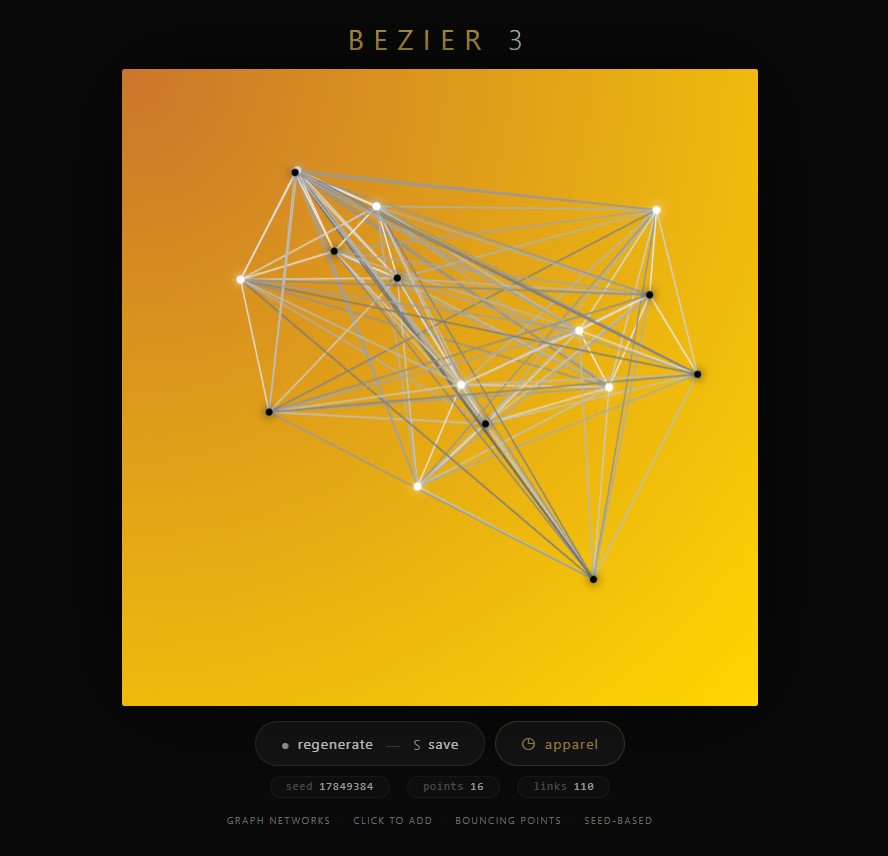
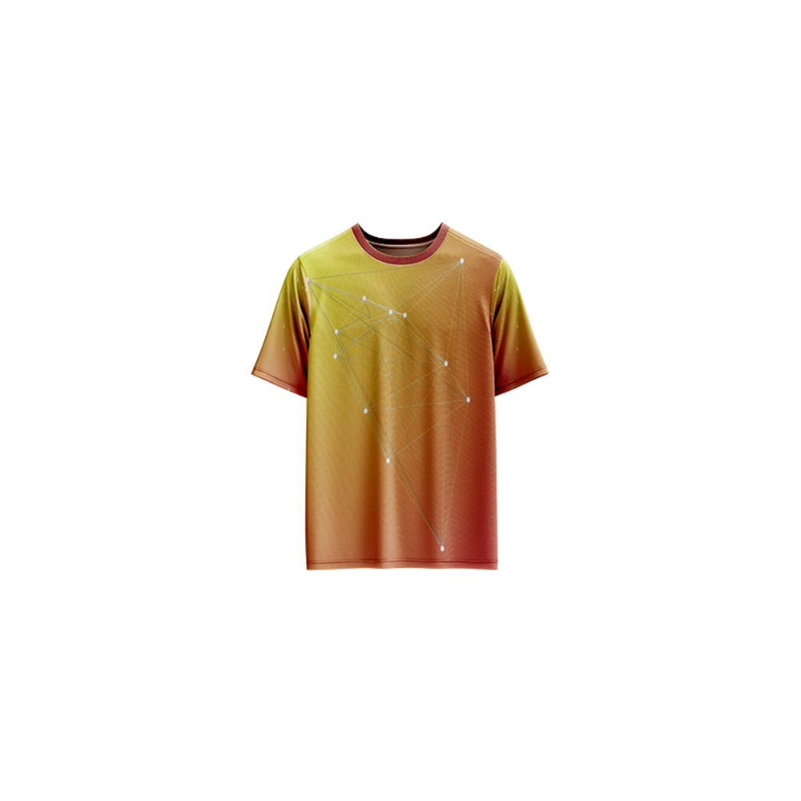

# Brownian Graphe — Generative Art

[](https://reyrove.github.io/Brownian-Graphe-Generative-Art)
[](https://opensource.org/licenses/MIT)

> **Interactive generative graph networks with Brownian motion.** Each refresh creates a unique network of bouncing points connected by dynamic lines. Click to add new points and watch the network evolve.

## 🎨 Live Demo

<div align="center">
  <a href="https://reyrove.github.io/Brownian-Graphe-Generative-Art" target="_blank">
    
  </a>
  <br><br>
  <a href="https://reyrove.github.io/Brownian-Graphe-Generative-Art" target="_blank">
    
  </a>
  <br>
  <em>Click the image or button to experience the generative art</em>
</div>

## 👕 Apparel Preview

<div align="center">
  
  <br>
  <em>Brownian Graphe artwork printed on a T-shirt</em>
</div>

## ✨ Features

- **Interactive Graph Network** — Click to add new points to the network
- **Brownian Motion** — Points move with random, organic movement
- **Collision Detection** — Points bounce off each other and change color
- **Auto-Connections** — New points automatically connect to existing ones
- **Gradient Background** — Diagonal gradient with two random colors
- **Seed-Based** — Every composition is unique and reproducible via its seed
- **Save & Share** — Download as PNG with seed in filename
- **Apparel Mode** — Preview artwork on a T-shirt mockup
- **Responsive** — Works on desktop, tablet, and mobile
- **Pure JavaScript** — No external libraries (except favicon)
- **Keyboard Shortcuts**:
  - `R` — Regenerate
  - `S` — Save image
  - `T` — Toggle apparel view
  - `Click` — Add new point to network

## 🎨 Artwork Details

| Parameter | Range | Description |
|-----------|-------|-------------|
| **Initial Points** | 3–15 | Random starting points |
| **Minimum Links** | 1–4 | Each point connects to this many others |
| **Background Colors** | 70+ options | Two random colors for gradient |
| **Point Diameter** | Variable | Scales with canvas size |
| **Movement Speed** | Variable | Random Brownian motion |
| **Interactive** | Click to add | Add new points anytime |

## 🚀 Quick Start

### Local Development

```bash
# Clone the repository
git clone https://github.com/reyrove/Brownian-Graphe-Generative-Art.git

# Navigate to the directory
cd Brownian-Graphe-Generative-Art

# Open in browser
open index.html
# or use a live server
```

### Deploy to GitHub Pages

1. Push to GitHub
2. Go to Settings → Pages
3. Select branch `main` and root folder
4. Your site will be live at `https://reyrove.github.io/Brownian-Graphe-Generative-Art`

## 🧠 How It Works

The artwork is generated using a deterministic random number generator, seeded by timestamp + random noise. Every refresh:

1. **Setup**:
   - Chooses two random colors for diagonal gradient background
   - Generates 3-15 random points on the canvas
   - Each point connects to random other points

2. **Brownian Motion Animation**:
   - Points move with random velocities (Brownian motion)
   - Points bounce off canvas walls
   - When points collide, they exchange velocities and change color
   - Lines connect connected points with varying opacity

3. **Interaction**:
   - Click anywhere on the canvas to add a new point
   - New point automatically connects to random existing points
   - Network grows and evolves organically

4. **Rendering**:
   - Diagonal gradient background
   - Lines drawn between connected points
   - Points drawn as circles with glow effect

## 📁 File Structure

```
Brownian-Graphe-Generative-Art/
├── index.html              # Main application (all-in-one)
├── Brownian-Graphe.jpg     # T-shirt mockup image
├── fav.svg                 # Favicon
├── demo-screenshot.jpg     # Website demo screenshot
├── README.md               # This file
└── LICENSE                 # MIT License
```

## 🛠️ Tech Stack

- **Pure Vanilla HTML/CSS/JS** — No dependencies
- **Canvas API** — 2D rendering
- **CSS Flexbox/Grid** — Responsive layout
- **GitHub Pages** — Hosting

## 🎯 Interactive Controls

| Action | Keyboard | Button |
|--------|----------|--------|
| Add Point | Click on canvas | — |
| Regenerate | `R` | Click "regenerate" |
| Save Image | `S` | Click "regenerate" |
| Toggle Apparel | `T` | Click "apparel" |

## 🎨 The Creative Process

### Brownian Motion
Named after botanist Robert Brown, Brownian motion is the random movement of particles in a fluid. Here, each point moves with random velocity, creating organic, natural-looking movement patterns.

### Network Growth
Initially, 3-15 points are placed randomly. Each point connects to random other points. Clicking on the canvas adds a new point that automatically connects to existing ones, allowing the network to grow organically.

### Visual Design
The diagonal gradient background uses two random colors from a palette of 70+ colors. Lines between points fade from white to black based on distance. Points glow with a subtle shadow effect and alternate between black and white upon collision.

## 📱 Responsive Design

The application automatically adapts to:
- Desktop screens
- Tablets
- Mobile phones
- Landscape orientation
- Various aspect ratios

## 🤝 Contributing

Contributions are welcome! Feel free to:
- Fork the repository
- Create a feature branch
- Submit a pull request

### Ideas for Contributions:
- New movement algorithms
- Additional color palettes
- Enhanced interaction features
- Performance optimizations
- GIF export functionality

## 📄 License

MIT License — see [LICENSE](LICENSE) file for details.

## 🙏 Acknowledgments

- Inspired by Brownian motion and graph networks
- Pure JavaScript implementation
- Special thanks to the creative coding community

---

**Built with ❤️ and Brownian motion**